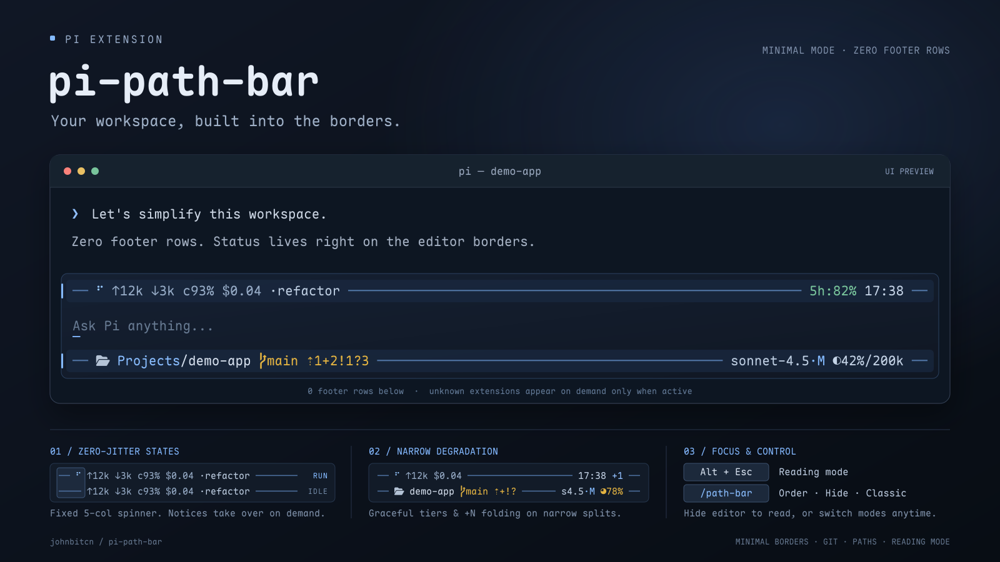

# pi-path-bar

English | [简体中文](README.zh-CN.md)

Built for small screens and narrow splits. **pi-path-bar** removes Pi's multi-line footer so your conversation has more room, and adds a one-keystroke reading mode — while keeping your path, Git status, usage, model, and local time in plain sight.



## Minimal mode

Enabled by default. On laptops and split panes, a stacked footer wastes vertical space and breaks awkwardly when the terminal gets narrow. Minimal mode fixes both:

- **Zero footer rows:** Everything moves cleanly onto the editor's top and bottom borders, giving your conversation more vertical space.
- **Smooth on narrow splits:** As the window shrinks, parent folders, Git numbers, model names, and context limits step down automatically, and extra right-side items fold into `+N`. Nothing wraps or jumbles.
- **Calm, jitter-free status:** Text stays locked in place when Pi starts or finishes running. Rare notices like retries or compaction appear when needed and clear out right after.
- **Clean with other extensions:** Popular usage and status extensions stay compact on the top border automatically. Any other extension status appears below only while active and hides when empty.
- **Easy to switch back:** Turn **Minimal mode** off anytime in `/path-bar` to use the classic multi-line footer or Pi's native footer.

## Reading mode

Long answers and diffs feel cramped on a small screen when the editor sits at the bottom. Reading mode clears the whole frame in one keystroke:

- **`Alt+Esc`** (Mac: **`Option+Esc`**) or **`/reading-mode`**: hide the editor and footer so you can scroll through conversation and tool output distraction-free.
- **`Esc`** or **`Alt+Esc`** again: return to typing immediately with your draft still intact.

Requires Pi 1.5 or later in fullscreen mode. Use `/reading-mode` if the shortcut does not respond, and run `/reload` after switching TUI modes.

## Installation

```sh
pi install npm:pi-path-bar
```

Or install from GitHub:

```sh
pi install git:github.com/johnbitcn/pi-path-bar
```

In an existing Pi session, run `/reload`, then `/path-bar` to customize settings.

Load only one copy of the extension. Folder icons require a Nerd Font, or you can turn them off in settings.

## Settings

Run `/path-bar`. Use the arrow keys to choose an item, Enter or Space to change it, and Esc to close. Changes apply right away and save automatically. The menu uses English.

| Setting | Default | Choices |
| --- | --- | --- |
| Minimal mode | On | On, Off |
| Path display | Short | Short, Auto, Full, Native footer |
| Folder icon | On | On, Off |
| Git status | On | On, Off |
| Session name | On | On, Off |
| Time format | 24h | 24h, 12h (AM/PM) |
| Footer order | — | Reorder or hide right-side items and clock |
| Add folder alias | — | Name any folder for a shorter display |
| Manage folder aliases | — | Edit or remove aliases |

- **Short:** abbreviate parent folders and keep the current folder name full.
- **Auto:** show the full path when there is room; otherwise abbreviate it.
- **Full:** keep the full path and truncate only at the edge.
- **Native footer:** restore Pi's built-in footer without losing your settings.

When **Minimal mode** is off, `pi-path-bar` renders a compact multi-line footer with local time on the right:


### Reorder or hide items

Open **Footer order** in `/path-bar` to control what appears on the right side of the bar (including the clock and other extensions). Use `up` / `down` to select, `<` / `>` (or `,` / `.`) to move, and `Space` to show or hide.

Put what matters most on the left — narrow terminals keep leftmost items visible and fold the rest into `+N`.

Extension authors: see [footer segments](https://github.com/johnbitcn/pi-path-bar/blob/main/docs/footer-segments.md).

## Folder aliases

Replace long paths with short names you recognize at a glance. Choose **Add folder alias** in `/path-bar`, enter a path (or leave blank for the current directory), and give it a name.

For example, naming `~/CloudDrive/Projects/demo-app` **demo** shortens it and all subfolders:


- Aliases apply to the folder and its subfolders (the most specific match wins).
- Edit or remove aliases anytime in **Manage folder aliases** — your actual folders are never touched.

## Git status

See branch state and changes without running `git status`. Colors follow your active Pi theme (blue when clean, yellow with changes, red on conflicts or active Git operations) and hide outside a repository.


| Indicator | Meaning |
| --- | --- |
| `⇣N` / `⇡N` | Behind / ahead of upstream |
| `*N` | Stash entries |
| `~N` | Conflicted files |
| `+N` | Staged changes |
| `!N` | Unstaged changes |
| `?N` | Untracked files |

## Notes

- Settings are shared across projects and saved in `~/.pi/agent/pi-path-bar.json`.
- Avoid enabling multiple footer-replacement extensions at the same time.
- When upgrading from the standalone reading-mode script, remove `-e ./src/reading-mode.ts` from your launch arguments.

## License

[MIT](LICENSE). See [Third-party notices](THIRD_PARTY_NOTICES.md) for related copyright and license texts. This unofficial extension is not affiliated with or endorsed by Pi or Tide.
