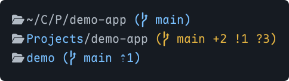
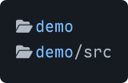
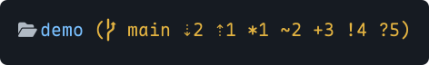

# pi-path-bar

English | [简体中文](README.zh-CN.md)

A Pi extension for a compact footer and focused reading. Shows paths, folder aliases, Git status, and local time. Keeps usage statistics, model information, and other extension status lines.



## Installation

```sh
pi install npm:pi-path-bar
```

Or install from GitHub:

```sh
pi install git:github.com/johnbitcn/pi-path-bar
```

In an existing Pi session, run `/reload`, then `/path-bar` to open settings.

Load only one copy of the extension. Folder icons require a Nerd Font, or you can turn them off in settings.

## Settings

Run `/path-bar`. Use the arrow keys to select an item, Enter or Space to change it, and Esc to exit. Changes apply immediately and are saved automatically. The menu uses English.

| Setting | Default | Choices |
| --- | --- | --- |
| Path display | Short | Short, Auto, Full, Native footer |
| Folder icon | On | On, Off |
| Git status | On | On, Off |
| Session name | On | On, Off |
| Time format | 24h | 24h, 12h (AM/PM) |
| Add folder alias | — | Enter a folder path and a name |
| Manage folder aliases | — | Edit or delete aliases |

- **Short:** abbreviate intermediate folders and keep the final folder name.
- **Auto:** show the full path when space allows; otherwise abbreviate it.
- **Full:** do not abbreviate; truncate if needed.
- **Native footer:** restore Pi's built-in footer without losing your settings.

Local time appears at the right of the path line. The home directory is shown as `~`. Unicode folder names are supported.

## Folder aliases

Choose **Add folder alias**, then enter a folder path and a display name. Use an absolute path or `~/`, or leave the path blank for the current directory.

For example, name `~/CloudDrive/Projects/demo-app` **demo**:



- An alias applies to its folder and descendants. If several aliases match, the longest path wins.
- Use **Manage folder aliases** to edit or delete them. Leave a field blank to keep its value; Esc cancels.
- Aliases change only the display name. Deleting an alias does not delete the folder.

## Git status



| Indicator | Meaning |
| --- | --- |
| `⇣N` / `⇡N` | N commits behind / ahead of upstream |
| `*N` | N stash entries |
| `~N` | N conflicted files |
| `+N` | N staged entries |
| `!N` | N unstaged entries |
| `?N` | N untracked entries |

In the default themes, blue means clean, yellow means changes, and red means conflicts or an active Git operation. Colors follow your theme. Git information is hidden outside a repository.

## Reading mode

Loaded automatically with the extension. Enter with the shortcut or command.

- **`Alt+Esc`** (Mac: **`Option+Esc`**): hide the editor and footer. Conversation and tool output remain available for scrolling.
- **A single `Esc`** or **`Alt+Esc`** again: restore the interface and keep your draft.
- You can also enter with **`/reading-mode`**.

Requires Pi 1.5 or later in fullscreen mode. Use the command if the shortcut does not respond. Run `/reload` after switching TUI modes.

When upgrading from the standalone version, remove the `-e ./src/reading-mode.ts` launch argument to avoid loading it twice.

## Notes

- Settings are shared across projects and saved automatically. The default file is `~/.pi/agent/pi-path-bar.json`.
- Avoid enabling multiple footer-replacement extensions at once; they can override each other.
- The custom footer does not show the native `(auto)` marker.

## License

[MIT](LICENSE). See [Third-party notices](THIRD_PARTY_NOTICES.md) for related copyright and license texts. This unofficial extension is not affiliated with or endorsed by Pi or Tide.
