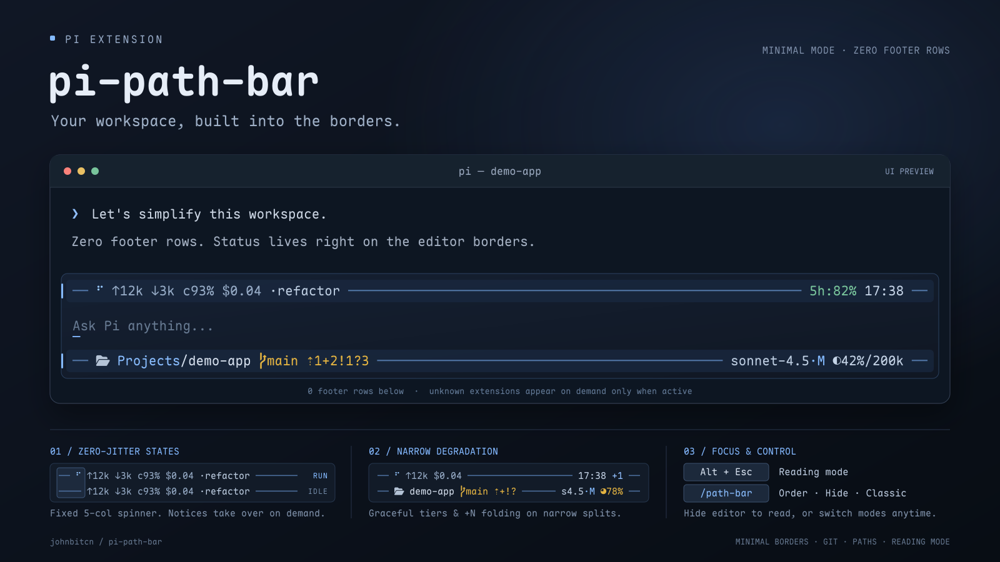
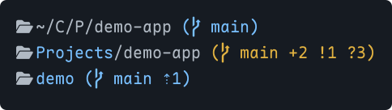
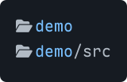
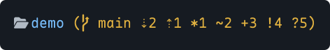

# pi-path-bar

[English](README.md) | 简体中文

专为小屏幕与窄分屏优化的 Pi 扩展。移除底栏占行、支持一键全屏阅读，把宝贵的终端空间还给对话，同时让你一眼看清路径、Git 状态、用量、模型与时间。



## 极简模式（Minimal mode）

默认开启。在笔记本小屏或分屏终端里，传统多行底栏既占高度，变窄时又容易折行错乱。极简模式直接解决这两个痛点：

- **零底栏占行**：隐藏底部状态行，把关键信息干净地嵌进输入框上下横线，留出更多对话阅读空间。
- **窄屏自动瘦身**：空间不足时精简父目录、Git 计数和上下文上限。模型名从左侧截断，优先保留右侧的模型代号。放不下的右侧项折叠为 `+N`。
- **运行不跳动**：开始与结束运行时，状态文字位置纹丝不动；遇到重试或压缩等提醒时自动浮现，结束后恢复清净。
- **扩展共存清爽**：常见用量与状态扩展会自动以紧凑样式留在上横线；其他扩展仅在有提示时临时出现一行，空闲时彻底隐藏。
- **随时切回**：在 `/path-bar` 中关闭 **Minimal mode**，即可随时恢复传统多行底栏或 Pi 原生底栏。

## 阅读模式（Reading mode）

小屏幕看长回复、长代码或工具输出时，底部的输入框会占掉一大块视野。按一次快捷键即可沉浸阅读：

- **`Alt+Esc`**（Mac：**`Option+Esc`**）或执行 **`/reading-mode`**：立即隐藏输入框与底栏，全屏自由滚动浏览对话和输出。
- **单按 `Esc`** 或再按一次 **`Alt+Esc`**：瞬间回到输入状态，没发出去的草稿完整保留。

需要 Pi 1.5 及以上版本的 fullscreen 模式。若快捷键无响应，可直接输入 `/reading-mode`；切换 TUI 模式后请执行 `/reload`。

## 安装

```sh
pi install npm:pi-path-bar
```

也可从 GitHub 安装：

```sh
pi install git:github.com/johnbitcn/pi-path-bar
```

在已运行的 Pi 中执行 `/reload`，再输入 `/path-bar` 即可自定义设置。

请只加载一份扩展。目录图标需要 Nerd Font，也可在设置中关闭。

## 设置

执行 `/path-bar`。上下键选择，Enter 或空格切换，Esc 退出。修改立即生效并自动保存。设置菜单使用英文。

| 设置项 | 默认值 | 说明 |
| --- | --- | --- |
| Minimal mode（极简模式） | On | 开启或关闭极简边框模式 |
| Path display（路径显示） | Short | Short、Auto、Full、Native footer |
| Folder icon（目录图标） | On | 显示或隐藏目录图标 |
| Git status（Git 状态） | On | 显示或隐藏 Git 状态 |
| Session name（会话名称） | On | 显示或隐藏会话名 |
| Time format（时间格式） | 24h | 24h 或 12h（AM/PM） |
| Footer order（右侧排序与隐藏） | — | 调整右侧项目顺序，或按空格隐藏任意项与时钟 |
| Add folder alias（添加目录别名） | — | 给常用目录起一个更短的显示名 |
| Manage folder aliases（管理目录别名） | — | 修改或删除已有别名 |

- **Short**：缩写中间目录，保留当前目录全名。
- **Auto**：空间够时显示完整路径，不够时自动缩写。
- **Full**：保持完整路径，仅在超出宽度时截断。
- **Native footer**：恢复 Pi 原生底栏，保留已有设置。

关闭 **Minimal mode** 后，会恢复为紧凑的多行底栏：



### 调整顺序或隐藏项目

在 `/path-bar` 中进入 **Footer order**，即可自由调整右侧显示内容（包括时钟及其他扩展）：上下键选中，`<` / `>`（或 `,` / `.`）左右移动，`Space` 切换显示或隐藏。

把最关心的项目移到左边——分屏变窄时会优先保留左侧项目，其余折叠为 `+N`。

扩展作者请参考[底栏片段文档](https://github.com/johnbitcn/pi-path-bar/blob/main/docs/footer-segments.md)。

## 目录别名

给深层目录起一个顺眼的短名字，小屏下辨识更轻松。在 `/path-bar` 中选择 **Add folder alias**，输入目录路径（留空即当前目录）和名称即可。

例如，把 `~/CloudDrive/Projects/demo-app` 命名为 **demo**：



- 别名对该目录及所有子目录生效（多层匹配时优先最具体的路径）。
- 随时可在 **Manage folder aliases** 中修改或删除，不会影响真实文件夹。

## Git 状态

不用切出去敲 `git status`，一眼看清分支与改动。颜色自动跟随当前 Pi 主题（默认蓝色表示干净，黄色表示有变更，红色表示冲突或正在进行 Git 操作），不在仓库内时自动隐藏。



| 标记 | 含义 |
| --- | --- |
| `⇣N` / `⇡N` | 落后 / 领先上游提交数 |
| `*N` | Stash 数量 |
| `~N` | 冲突文件数 |
| `+N` | 已暂存更改 |
| `!N` | 未暂存更改 |
| `?N` | 未跟踪文件 |

## 注意事项

- 设置跨项目共享，自动保存在 `~/.pi/agent/pi-path-bar.json`。
- 请避免同时启用多个修改底栏的扩展，以免互相覆盖。
- 从独立版阅读模式升级时，请移除启动参数中的 `-e ./src/reading-mode.ts`。

## 许可证

[MIT](LICENSE)。相关项目版权与许可见[第三方声明](THIRD_PARTY_NOTICES.md)。本项目是非官方扩展，与 Pi 或 Tide 无隶属或背书关系。
