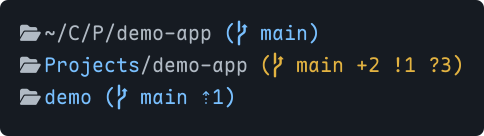
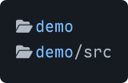

# pi-path-bar

[English](README.md) | 简体中文

Pi 底栏与阅读模式扩展。显示简短路径、目录别名、Git 状态和本机时间，保留用量统计、模型信息及其他扩展的状态行。



## 安装

```sh
pi install npm:pi-path-bar
```

也可从 GitHub 安装：

```sh
pi install git:github.com/johnbitcn/pi-path-bar
```

在已运行的 Pi 中执行 `/reload`，再输入 `/path-bar` 打开设置。

只加载一份扩展。目录图标需要 Nerd Font，也可在设置中关闭。

## 设置

执行 `/path-bar`。上下键选择，Enter 或空格修改，Esc 退出。修改立即生效并自动保存。设置菜单使用英文。

| 设置项 | 默认值 | 可选值 |
| --- | --- | --- |
| Path display（路径显示） | Short | Short、Auto、Full、Native footer |
| Folder icon（目录图标） | On | On、Off |
| Git status（Git 状态） | On | On、Off |
| Session name（会话名称） | On | On、Off |
| Time format（时间格式） | 24h | 24h、12h（带 AM/PM） |
| Add folder alias（添加目录别名） | — | 输入文件夹路径和名称 |
| Manage folder aliases（管理目录别名） | — | 修改或删除别名 |

- **Short：**缩写中间目录，保留最后一级目录名。
- **Auto：**空间足够时显示完整路径，否则缩写。
- **Full：**不缩写，超出宽度时截断。
- **Native footer：**恢复 Pi 原生底栏，保留已有设置。

时间显示在路径行右侧，使用本机时区。主目录显示为 `~`，支持中文目录名。

## 目录别名

选择 **Add folder alias**，输入文件夹路径和显示名称。支持绝对路径和 `~/`；路径留空则使用当前目录。

例如，将 `~/CloudDrive/Projects/demo-app` 命名为 **demo**：



- 别名适用于该目录及其子目录。多个别名匹配时，使用路径最长的别名。
- 在 **Manage folder aliases** 中修改或删除。修改时留空表示保留原值，Esc 取消。
- 别名只改变显示名称。删除别名不会删除文件夹。

## Git 状态


| 标记 | 含义 |
| --- | --- |
| `⇣N` / `⇡N` | 落后 / 领先上游 N 个提交 |
| `*N` | N 条 stash |
| `~N` | N 个冲突文件 |
| `+N` | N 个已暂存条目 |
| `!N` | N 个未暂存条目 |
| `?N` | N 个未跟踪条目 |

默认主题中，蓝色表示干净，黄色表示有变更，红色表示有冲突或正在进行 Git 操作。颜色随主题调整。不在 Git 仓库时隐藏 Git 信息。

## 阅读模式

随扩展自动加载，按快捷键或执行命令进入。

- **`Alt+Esc`**（Mac：**`Option+Esc`**）：隐藏输入框和底栏，保留对话及工具输出，可继续滚动阅读。
- **单次 `Esc`** 或再次 **`Alt+Esc`**：恢复界面，输入草稿保留。
- 也可执行 **`/reading-mode`** 进入。

需要 Pi 1.5 或更新版本的 fullscreen 模式。快捷键无响应时使用命令。切换 TUI 模式后，请执行 `/reload`。

从独立版本升级时，请移除 `-e ./src/reading-mode.ts` 启动参数，避免重复加载。

## 注意事项

- 设置跨项目共用，自动保存；默认文件为 `~/.pi/agent/pi-path-bar.json`。
- 不要同时启用多个修改底栏的扩展，以免相互覆盖。
- 自定义底栏不显示原生 `(auto)` 标记。

## 许可证

[MIT](LICENSE)。相关项目的版权及许可见[第三方声明](THIRD_PARTY_NOTICES.md)。本项目是非官方扩展，与 Pi 或 Tide 无隶属或背书关系。
